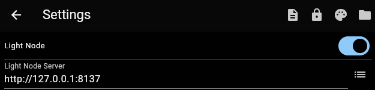

# Nym RPC

A privacy-preserving RPC proxy that routes RPC requests through the [Nym mixnet](https://nym.com/) to protect metadata and enhance privacy for blockchain interactions.

> ⚠️ **Note**: This project is currently under active development and not yet ready for production use. See [TODO](#todo) section below for planned features and improvements.

## 🚀 Quick start: private Zcash wallet with zkool

Run the [zkool](https://github.com/hhanh00/zkool2) Zcash wallet over the Nym
mixnet in three steps. No account, no config files — just a download and one
command.

**1. Download the client.** Grab `nym-rpc-client-linux-x86_64` from the
[latest release](https://github.com/rachyandco/nym-rpc/releases) and make it
executable:

```bash
chmod +x nym-rpc-client-linux-x86_64
```

**2. Start the tunnel** pointing at the live Zaino-over-Nym server. Leave it
running — it listens on `127.0.0.1:8137`:

```bash
./nym-rpc-client-linux-x86_64 --zcash \
  -x BbTPrU1gNTsPiieXdC58xkp5QFSHhUUM98BP1Rm2adf9.GKiGLNQB116YszFwbuweeL2GsrfpHpuUzq6JuqFQ8EEE@ZXSDhRTKU5HgMpH8ma78FftvLiKyZ6jWL1e2U7GD7gQ
```

You should see `Raw tunnel listening on 127.0.0.1:8137`. (Press Ctrl+C to
stop it when you're done.)

**3. Point zkool at it.** Open zkool → **Settings**, turn on **Light Node**,
and set **Light Node Server** to `http://127.0.0.1:8137`:



That's it — zkool now syncs and sends over the Nym mixnet. Your wallet traffic
reaches Zcash without ever exposing your IP to the light-wallet server.

> First sync over the mixnet is slow (it streams a lot of blocks); it's best
> for ongoing refresh and sending. A broadcast may briefly show an error even
> when it succeeded — check the transaction on a block explorer before
> resending.

## Overview

Nym RPC enables anonymous and private access to blockchain RPC endpoints by routing requests through the Nym mixnet. This protects users' IP addresses, request patterns, and other metadata from being exposed to RPC providers.

The system uses **full TLS encryption** end-to-end, ensuring that not even the final Nym exit node can see the content of your RPC requests - only the destination server can decrypt and read the actual request data.

### How it works

```
Client App → HTTP Proxy (localhost:8545) → TCP Proxy Client → Nym Mixnet → TCP Proxy Server → RPC Provider
```

1. **HTTP Proxy**: Runs a local HTTP proxy server that accepts standard RPC requests, forwards them to a specified provider.
2. **TCP Proxy Client**: Inserts UPSTREAM packet information and sends through the Nym mixnet
3. **Mixnet**: Routes requests through the Nym mixnet for privacy
4. **TCP Proxy Server**: Receives requests from mixnet, extracts UPSTREAM packet info, and forwards to target RPC provider

See [architecture diagram](./docs/architecture_diagram.mmd) for visual representation of the whole flow.

## Features

- 🔒 **Privacy-first**: All requests routed through Nym mixnet
- 🚀 **Drop-in replacement**: Compatible with existing RPC clients
- ⚡ **Connection pooling**: Maintains NYM client pools for optimal performance
- 🌐 **Multi-provider support**: Works with any JSON-RPC endpoint
- 🛠️ **Easy configuration**: Simple CLI interface

## TODO

- detect misbehaving nodes
- allowlist
- node discovery
- memory: prune sessions

## Installation

```bash
cargo build --release
```

## Usage

1. (optional) Run a `nym-rpc-server` on a VM
2. Copy it's NYM address displayed in the logs
3. Run `nym-rpc-client` on your laptop and specify `nym-rpc-server` as exit-node.
4. If you don't specify an exit-node, it will use one of the four available.

```bash
nym-rpc-client -x <nym-rpc-server-address> -r <RPC_PROVIDER_URL>
```

4. Confirm it works

```bash
curl -vX POST http://localhost:8545 \
  -H 'Content-Type: application/json' \
  -d '{"jsonrpc":"2.0","method":"eth_blockNumber","params":[],"id":1}'
```

5. Connect with your wallet (http://localhost:8545)

### Metamask ETH Mainnet

- Make sure `nym-rpc-client` is running and http://localhost:8545 is available
- Go to metamask and add a new RPC for Ethereum Mainnet
  - Do not try to add it into test networks, this will not work
- Add 'http://localhost:8545'

## Zcash / Zaino over Nym

`nym-rpc` also tunnels the Zcash [Zaino](https://github.com/zingolabs/zaino)
lightwalletd-compatible gRPC service through the mixnet, for wallets like
[zingo-cli](https://github.com/zingolabs/zingolib) / Zingo PC.

```
Wallet (zingo-cli, etc.) → local raw listener (127.0.0.1:8137) → Nym Mixnet → pinned exit (nym-rpc-server) → Zaino
```

Unlike the HTTP RPC mode above, this uses `--raw`/`--zcash` mode: the client
opens a raw TCP listener and pipes bytes through the mixnet unmodified
(required for gRPC, which isn't plain HTTP/JSON), and the server pins every
session to a single upstream instead of letting clients choose one.

### Server (VM running Zaino)

```bash
./target/release/nym-rpc-server \
  --config-dir /var/lib/nym-rpc/state \
  --pin-upstream 127.0.0.1:8137
```

`--pin-upstream <host:port>` is **required** for public operation — without
it the server is an open relay that forwards to whatever upstream a client
requests. It prints its Nym address on startup (also available at
`GET /api/v1/nym-address` on the HTTP API, default `127.0.0.1:8080`); publish
that address to your users. Two more flags harden a public deployment:
`--session-idle-timeout <secs>` (default `3600`) closes sessions with no
traffic in either direction, and `--max-sessions <n>` (default `512`) caps
concurrent sessions. Monitoring stats (active/total sessions, bytes
forwarded) are exposed at `GET /api/v1/stats`.

> ⚠️ On a public deployment the HTTP API listener **must** stay on loopback or
> behind a firewall (never `0.0.0.0`): the live session and byte counters in
> `/api/v1/stats` are traffic-sensitive and would let an observer correlate
> mixnet flows with this exit, undermining the anonymity the tunnel provides.
> Note also that the mixnet only encrypts traffic between the client and this
> exit — the exit↔Zaino hop is plaintext h2c, so Zaino must likewise stay
> bound to loopback on the same host.

### Client (laptop)

```bash
./target/release/nym-rpc-client --zcash -x <NYM_ADDRESS>
```

`--zcash` is a preset for `--raw` mode that listens on `127.0.0.1:8137` and
targets a Zaino upstream; `-x <NYM_ADDRESS>` is the server's Nym address from
above (required — there's no default exit node for Zcash traffic until one is
published as `ZCASH_SERVICE_NYM_ADDRESS` in `src/client_config.rs`).

### Connect your wallet

Point your wallet at `http://127.0.0.1:8137` as its lightwalletd server, e.g.:

```bash
zingo-cli --server http://127.0.0.1:8137 --data-dir /tmp/zingo-nym-test info
```

**Limitation**: initial wallet sync over the mixnet is slow (the mixnet adds
latency and the sync involves fetching a large range of compact blocks), so
this tunnel is best suited for wallets that already have a synced state —
i.e. periodic refresh and transaction submission — rather than syncing a
wallet from birth height for the first time.

### Operator smoke test

After deploying `nym-rpc-server` pinned at a live `zainod`/Zaino instance,
verify the tunnel end-to-end before publishing the Nym address:

```bash
# terminal 1 (on the VM, or a machine with zainod at 127.0.0.1:8137)
./target/release/nym-rpc-server --config-dir /tmp/nym-rpc-zcash --pin-upstream 127.0.0.1:8137
# note the printed Nym address

# terminal 2 (laptop)
./target/release/nym-rpc-client --zcash -x <NYM_ADDRESS>

# terminal 3 (laptop) — zingo-cli from zingolib
cargo run --release --package zingo-cli -- \
  --server http://127.0.0.1:8137 --data-dir /tmp/zingo-nym-test info
```

Expected: `info` returns the lightwalletd info block (vendor/taddr height)
through the mixnet.
